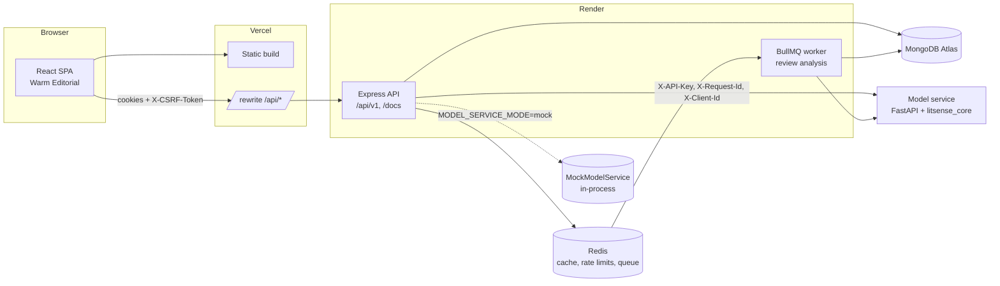
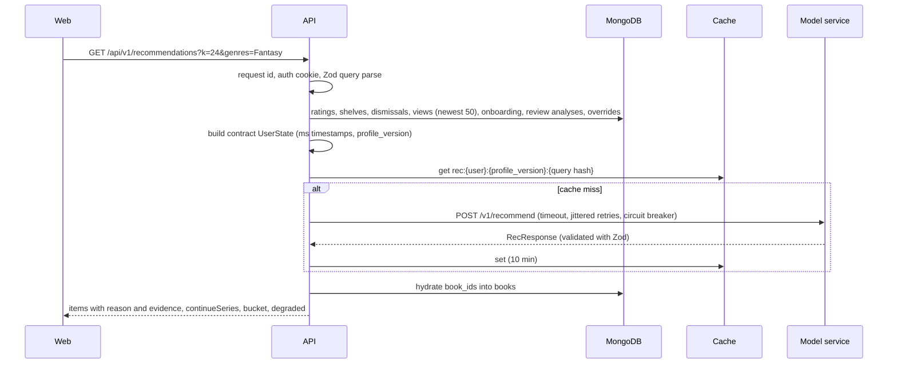

# LitSense

**A review-aware, explainable and conversational book recommender.** LitSense learns what a reader
loved about a book, not just that they rated it, and says in plain words why each pick made the page.

This repository is the web application (MERN, TypeScript). The recommendations themselves come from
`litsense_core`, the ML package in [zee10524/LightGcn](https://github.com/zee10524/LightGcn), served over
HTTP by the model service. The API talks to it through one typed client; an in-process mock with the
same contract lets everything here run without Python.

| Part              | What it is                                                                                              |
| ----------------- | ------------------------------------------------------------------------------------------------------- |
| `apps/web`        | React 18, Vite, React Router, TanStack Query, Zustand. The "Warm Editorial" design from the prototype.  |
| `apps/api`        | Node 20, Express 5, TypeScript (strict), Mongoose, Zod. Routes, controllers, services, repositories.    |
| `packages/shared` | Zod schemas mirroring `litsense_core/schemas.py` (contract 0.1.0) plus the API DTOs, used by both apps. |
| `prototype/`      | The original HTML/CSS/JS prototype the web app was ported from (kept for reference).                    |

## Architecture



How a recommendation request flows:



Key decisions:

- **The core stays stateless.** The API rebuilds the contract `UserState` from MongoDB on every model
  call (`apps/api/src/services/userState.service.ts`) and stores what comes back (chat `SessionState`,
  review analyses). Every write that changes the state bumps `User.profileVersion`, so caches keyed by
  `(user, profile_version)` can never serve a stale feed.
- **Titles never come from generated text.** The web renders titles and covers from our `books`
  collection by `book_id`, as the contract requires.
- **Honest numbers.** The contract returns a rank, not a match percentage, so the prototype's match
  dial shows the pick's rank. Evaluation metrics that are `null` show as "n/a", never as zero.
- **Degrade, do not fail.** When the model service is down the breaker opens, model calls return
  `503 MODEL_UNAVAILABLE`, and accounts, shelves and ratings keep working (`/readyz` reports `degraded`).

## Run it locally

Requirements: Node 20 or newer, npm 10+, Docker Desktop (for MongoDB and Redis).

```bash
cp .env.example .env
```

```bash
docker compose up --build
```

That starts MongoDB, Redis, the API on <http://localhost:4000> (OpenAPI docs at <http://localhost:4000/docs>)
and the web app on <http://localhost:8080>. The API seeds the catalogue on first boot and uses the mock
model service unless `.env` says otherwise. Register an account and you land on onboarding.

For development with hot reload, run only the databases in Docker:

```bash
docker compose up -d mongo redis
```

```bash
npm install
```

```bash
npm run dev
```

The web dev server (<http://localhost:5173>) proxies `/api` to the API on port 4000, so cookies are
first party exactly as in production. Set `REDIS_URL=redis://localhost:6379` in `.env` to use Redis
for the cache, rate limits and BullMQ; leave it empty to use the in-memory equivalents and the inline
job runner.

Make yourself an admin by putting your email in `ADMIN_EMAILS` before you register; the footer then
links to `/admin` (service health, breaker state, evaluation metrics, catalogue reseed).

### Using the real model service

1. Start the model service (`main` of zee10524/LightGcn, see its `service/README.md`). It needs
   `SERVICE_API_KEY` and a bundle. To run it from this compose file, put `SERVICE_API_KEY` and
   `BUNDLE_URL` (and optionally `GEMINI_API_KEY`) in `.env.model`, point `MODEL_SERVICE_CONTEXT` at its
   checkout (default `../LitSense-service`) and use `docker compose --profile model up --build`. The
   bundle is downloaded once into the `model-bundle` volume; to use a bundle you already extracted, set
   `MODEL_BUNDLE_DIR` to that folder instead.
2. In `.env`: `MODEL_SERVICE_MODE=http`, `MODEL_SERVICE_URL=http://model:8000` (or its host),
   `MODEL_SERVICE_KEY=<the same value as the service's SERVICE_API_KEY>`. The API may start first: its
   boot seed retries (2 s doubling to 30 s) until the service has loaded its bundle, and `/readyz` is
   503 `not_ready` until the catalogue exists (`degraded` while the service is down or still loading).
3. Book ids are the core's `book_id`s, so switching catalogues needs a reseed. The seed refuses to
   silently remap ids; with `--reset` it clears reader data (ratings, shelves, reviews, chats).
   Within one service `data_version` ids never change, so a new bundle of the same data version
   reseeds in place and keeps reader data; a new data version renumbers ids, so the seed refuses it
   without `--reset` (it stores both versions with the catalogue):

```bash
npm run seed -- --source=model --reset
```

The client follows the service's published OpenAPI (`service/openapi.json`, version 0.1.0): kebab-case
routes such as `POST /v1/recommend`, `POST /v1/home-rails`, `POST /v1/chat-turn`,
`GET /v1/book-insights/{book_id}` and `GET /v1/catalog?offset=&limit=`, with the headers `X-API-Key`,
`X-Request-Id` and `X-Client-Id` (a keyed hash of the reader id, never an email). The routes live in one
table at the top of `apps/api/src/modelService/http.ts`, and every response is validated against the
published shapes (a mismatch is a `bad_response`, never guessed at). `apps/api/test/modelServiceContract.test.ts`
checks every request against a vendored copy of that OpenAPI and every MockModelService answer against
its response schemas, so the mock and the real service are interchangeable by config (refresh
`test/fixtures` and run `npm run gen:model-types -w @litsense/api` when the service changes).
LLM-backed calls (explain, chat, onboarding, review analysis) are retried only when they certainly did not
run: connection refused, 429 or 503. The seed pages `/v1/catalog` by offset until `total` and aborts if
`bundle_version` changes mid-read. Caches keyed by book id (insights, onboarding grid, feed, rails,
related books, search) include the catalogue's bundle version, so they roll over on a reseed. On boot the
API logs which reseed is needed when the service's `bundle_version` (in place) or `data_version` (with
`--reset`) differs from the ones the catalogue was seeded from.

The LLM routes (explanations, chat replies, onboarding parsing) were tested in template mode only;
setting `GEMINI_API_KEY` on the model service turns them on with no change in the Node app.

To run the end-to-end smoke test against a running model service instead of the mock (it uses its own
database, `litsense_e2e_live`, seeded from the service on first start; drop it when the service's
bundle changes):

```bash
E2E_MODEL_SERVICE_MODE=http E2E_MODEL_SERVICE_URL=http://localhost:8000 E2E_MODEL_SERVICE_KEY=<SERVICE_API_KEY> npm run test:e2e
```

## Environment variables

The API validates all of them at boot (`apps/api/src/config/env.ts`) and refuses to start in production
with a development secret. `.env.example` lists every one; only placeholders are committed.

| Variable                                    | Default                                       | Purpose                                                                                 |
| ------------------------------------------- | --------------------------------------------- | --------------------------------------------------------------------------------------- |
| `NODE_ENV`                                  | `development`                                 | `production` turns on Secure cookies and the secret check.                              |
| `PORT`                                      | `4000`                                        | API port.                                                                               |
| `MONGODB_URI`                               | `mongodb://127.0.0.1:27017/litsense`          | **Set in production** (MongoDB Atlas connection string).                                |
| `REDIS_URL`                                 | empty                                         | Enables the Redis cache, Redis rate-limit store and BullMQ. `rediss://` supported.      |
| `JWT_ACCESS_SECRET`                         | dev placeholder                               | **Set in production**, 32+ random characters.                                           |
| `ACCESS_TOKEN_TTL_S`                        | `900`                                         | Access token lifetime.                                                                  |
| `REFRESH_TOKEN_TTL_DAYS`                    | `30`                                          | Refresh token lifetime (rotated on every use).                                          |
| `CORS_ORIGINS`                              | `http://localhost:5173,http://localhost:8080` | **Set in production** to the web origin(s). Also the CSRF Origin allowlist.             |
| `COOKIE_SECURE`                             | `true` in production                          | Secure flag on cookies.                                                                 |
| `COOKIE_SAMESITE`                           | `lax`                                         | `none` only for a cross-site setup (requires Secure).                                   |
| `COOKIE_DOMAIN`                             | empty                                         | Optional cookie domain.                                                                 |
| `TRUST_PROXY`                               | `0`                                           | Proxies in front of the API: `1` behind nginx or Render, `2` behind Vercel plus Render. |
| `ADMIN_EMAILS`                              | empty                                         | Accounts registered with these emails get the admin role.                               |
| `MODEL_SERVICE_MODE`                        | `mock`                                        | `mock` (in-process) or `http` (the Python model service).                               |
| `MODEL_SERVICE_URL`                         | none                                          | Required for `http`.                                                                    |
| `MODEL_SERVICE_KEY`                         | none                                          | Required for `http`; sent as `X-API-Key` (the service's `SERVICE_API_KEY`).             |
| `MODEL_SERVICE_TIMEOUT_MS`                  | `4000`                                        | Timeout for fast calls (recommend, rails, search, insights).                            |
| `MODEL_SERVICE_SLOW_TIMEOUT_MS`             | `15000`                                       | Timeout for LLM-backed calls (explain, chat, onboarding, review analysis).              |
| `MODEL_SERVICE_RETRIES`                     | `2`                                           | Retries with full-jitter backoff on network errors, 429 and 5xx.                        |
| `BREAKER_FAILURE_THRESHOLD`                 | `5`                                           | Consecutive failures that open the circuit.                                             |
| `BREAKER_COOLDOWN_MS`                       | `30000`                                       | How long the circuit stays open before a trial call.                                    |
| `CACHE_TTL_S`                               | `600`                                         | Feed, rails and related-books cache lifetime.                                           |
| `RATE_LIMIT_MAX` / `_WINDOW_MS`             | `300` per `60000`                             | Global per-IP limit.                                                                    |
| `AUTH_RATE_LIMIT_MAX`                       | `10`                                          | Failed sign-in or sign-up attempts per IP per window.                                   |
| `CHAT_RATE_LIMIT_MAX`                       | `30`                                          | Chat turns per user per window.                                                         |
| `LOGIN_MAX_FAILURES` / `LOGIN_LOCK_MINUTES` | `5` / `15`                                    | Account lockout after repeated wrong passwords.                                         |
| `WORKER_IN_PROCESS`                         | `true`                                        | Run the BullMQ consumer inside the API (single instance deploys).                       |
| `SEED_ON_BOOT`                              | `true`                                        | Seed the catalogue when the books collection is empty.                                  |
| `LOG_LEVEL`                                 | `info`                                        | pino level (`silent` in tests).                                                         |

Web: `VITE_API_URL` (build time) is empty by default, which means "same origin". Keep it empty
behind the Vercel rewrite or the nginx proxy.

## Scripts

| Command                                    | What it does                                                          |
| ------------------------------------------ | --------------------------------------------------------------------- |
| `npm run dev`                              | API (tsx watch) and web (Vite) together.                              |
| `npm run build`                            | Builds shared, API and web.                                           |
| `npm run lint` / `npm run format`          | ESLint (flat config, max 0 warnings) and Prettier.                    |
| `npm run typecheck`                        | `tsc --noEmit` in every workspace.                                    |
| `npm test`                                 | Vitest in every workspace (API tests use mongodb-memory-server).      |
| `npm run test:e2e`                         | Playwright smoke test; needs MongoDB (`docker compose up -d mongo`).  |
| `npm run seed`                             | Seeds the catalogue (`-- --source=model` or `fixture`, `--reset`).    |
| `npm run openapi -w @litsense/api`         | Regenerates `apps/api/openapi.json` from the route table.             |
| `npm run dev:worker -w @litsense/api`      | Standalone BullMQ worker (when `WORKER_IN_PROCESS=false`).            |
| `npm run gen:model-types -w @litsense/api` | Regenerates the model-service client types from the vendored OpenAPI. |

A Husky pre-commit hook runs ESLint and Prettier on staged files (lint-staged).

## API

All endpoints live under `/api/v1`; the OpenAPI 3.1 document is generated from the same route table the
router uses (`/openapi.json`, browsable at `/docs`, committed as `apps/api/openapi.json`). Highlights:

| Area            | Endpoints                                                                                                                                           |
| --------------- | --------------------------------------------------------------------------------------------------------------------------------------------------- |
| Auth            | `GET /auth/csrf`, `POST /auth/register`, `/auth/login`, `/auth/refresh`, `/auth/logout`, `/auth/logout-all`                                         |
| Account         | `GET/PATCH/DELETE /me`, `PATCH /me/overrides` (muted genres, pinned aspects, AI off)                                                                |
| Library         | `GET /me/library`, `/me/stats`, `/me/recent-reads`; `PUT/DELETE /me/ratings/:id`, `/me/reading-list/:id`, `/me/dismissed/:id`; `POST /me/views/:id` |
| Reviews         | `PUT /me/reviews` (queues aspect analysis), `GET/DELETE /me/reviews/:id`, `GET /me/taste`                                                           |
| Onboarding      | `GET /onboarding/grid`, `GET/PUT /me/onboarding`, `PATCH /me/onboarding/profile`, `POST /me/onboarding/skip`                                        |
| Recommendations | `GET /recommendations`, `/recommendations/rails`, `/recommendations/:id/explanation`                                                                |
| Books           | `GET /books`, `/books/genres`, `/books/:id`, `/books/:id/insights`, `/similar`, `/more-by-author`, `GET /search`                                    |
| Chat            | `GET/POST /chat/sessions`, `GET/DELETE /chat/sessions/:id`, `POST .../messages`, `DELETE .../chips/:key`                                            |
| Admin           | `GET /admin/overview`, `GET /admin/metrics`, `POST /admin/catalog/reseed`                                                                           |
| Health          | `GET /healthz` (liveness), `GET /readyz` (Mongo, Redis, catalogue, model service)                                                                   |

Errors always look like `{ "error": { "code", "message", "details"?, "requestId" } }`. Lists are
cursor paginated (`?cursor=&limit=`, response `{ items, nextCursor }`). `PUT /me/ratings/:id` and
`PUT /me/reviews` honour an `Idempotency-Key` header (replayed for 24 h). Every request gets an
`X-Request-Id` (accepted from the caller or generated), forwarded to the model service and logged.

Chat follows contract section 4: the API stores `reply.session` verbatim, a clarification option is
sent back as the next message, and removing a chip deletes the matching field from the stored session
and re-runs the turn with an empty message.

## Security

- **Passwords**: argon2id (OWASP parameters). Unknown emails take the same time as wrong passwords.
- **Sessions**: 15-minute access JWT and a 30-day opaque refresh token, both in `HttpOnly` cookies
  (`Secure` in production, `SameSite=Lax`, refresh cookie scoped to `/api/v1/auth`). Refresh tokens are
  stored hashed and rotate on every use; replaying a rotated token revokes the whole family.
- **CSRF**: synchronizer token. `GET /auth/csrf` returns an HMAC-signed token and sets the same value in
  an `HttpOnly` cookie; every unsafe request must echo it in `X-CSRF-Token`, and its `Origin` must be in
  `CORS_ORIGINS`. Bearer-token clients carry no ambient credential and skip the check.
- **Brute force**: per-IP limit on failed sign-ins (Redis store when available) plus a per-account
  lockout (`423 ACCOUNT_LOCKED` with `Retry-After`).
- **Input**: Zod validates every body, query and path parameter; the simple query parser never builds
  nested objects; user strings reach MongoDB only through `$eq`, so operator injection is not possible.
  JSON bodies are capped at 100 kB.
- **Headers**: helmet with a `default-src 'none'` CSP on the API; the web nginx and Vercel configs set a
  strict CSP, `nosniff`, referrer and permissions policies.
- **Roles**: `user` and `admin`; admin routes are guarded server side.
- **Secrets**: none in the repo. `.env*` is git- and docker-ignored except `.env.example`; pino redacts
  cookies, authorization, CSRF and service-key headers and password fields.
- **Supply chain**: `npm audit --audit-level=high` runs in CI (currently 0 vulnerabilities).
- **Privacy**: `UserState.user_id` is always `null`; nothing identifying is sent to the model service.

## Tests

| Suite                                                                                   | Tool                                       | Count |
| --------------------------------------------------------------------------------------- | ------------------------------------------ | ----- |
| Shared contract (chip keys, schema rules)                                               | Vitest                                     | 7     |
| API unit (breaker, retry, HTTP client, mock contract behaviour)                         | Vitest                                     | 33    |
| API drift check (requests and mock responses against the model service's OpenAPI)       | Vitest + Ajv                               | 4     |
| API integration (auth, library, onboarding, chat, reviews, jobs, resilience, seeding)   | Vitest + supertest + mongodb-memory-server | 48    |
| Web unit (HTTP client, evidence parsing, components)                                    | Vitest + Testing Library                   | 13    |
| End to end (sign up, onboarding, recommendations, explain, dismiss, chat, chip removal) | Playwright                                 | 1     |

The API integration tests set `TEST_MONGO_URI` from an in-memory MongoDB; point it at a running server
(`docker compose up -d mongo`) to skip the binary download. CI (`.github/workflows/ci.yml`) runs lint,
format check, typecheck, all tests, the build and the audit, then the Playwright smoke test against a
MongoDB service container, then builds both Docker images.

## Deploy

1. **MongoDB Atlas**: create a cluster (M0 is enough), a database user, and allow Render's egress IPs
   (or 0.0.0.0/0 with a strong password). Copy the connection string.
2. **Redis** (optional but recommended): Upstash or Render Key Value; copy the `rediss://` URL.
   Without it the API uses in-memory cache, rate limits and inline jobs (fine for one instance).
3. **API on Render**: New, Blueprint, pick this repo (it reads `render.yaml`), or create a Docker web
   service with `apps/api/Dockerfile` and the repo root as context. Set `MONGODB_URI`, `REDIS_URL`,
   `CORS_ORIGINS=https://<your-app>.vercel.app`, `ADMIN_EMAILS`, and the model service variables.
   `JWT_ACCESS_SECRET` is generated by the blueprint. Health check path: `/healthz`.
4. **Model service**: deploy it per its own README, then set `MODEL_SERVICE_MODE=http`,
   `MODEL_SERVICE_URL` and `MODEL_SERVICE_KEY` on the API and run the seed once with `--source=model`.
5. **Web on Vercel**: import the repo, Root Directory `apps/web` (it reads `apps/web/vercel.json`).
   Edit the `/api/:path*` rewrite destination to your API URL. The rewrite keeps the API same origin,
   so cookies stay first party and `SameSite=Lax` works.
6. Check `https://<api>/readyz` and sign up on the Vercel URL.

## Project structure

```text
apps/api/src
  app.ts, server.ts, worker.ts      Express app, HTTP server with graceful shutdown, standalone worker
  config/env.ts                     Zod-validated configuration
  http/                             route table helper, controllers, middleware, cookies, OpenAPI
  services/                         auth, account, library, onboarding, recommendations, books, chat, reviews, admin, seed
  repositories/                     the only code that touches Mongoose models
  models/                           Mongoose schemas and indexes
  modelService/                     interface, HTTP client (retries, breaker), in-process mock and fixture
  jobs/                             BullMQ queue, inline fallback, review-analysis processor
apps/web/src
  api/                              fetch client (CSRF, refresh), endpoints, TanStack Query hooks
  app/                              layout, guards, router
  components/                       cover, cards, shelf control, evidence drawer, overlays, search, review dialog
  pages/                            one file per screen
  styles/prototype/                 the prototype's stylesheet and Warm Editorial skin, verbatim
packages/shared/src                 contract.ts (core schemas), api.ts (HTTP DTOs)
```

## Known limits

- The mock model service runs over the prototype's 40 books plus a three-book series; reasons and
  aspect bars are derived from the prototype's hand-written aspect scores.
- `analyze_user_review` results only influence recommendations after the background job finishes
  (usually under a second).
- Chat conversations idle for 30 days and explanation caches older than 7 days are deleted by TTL indexes.
